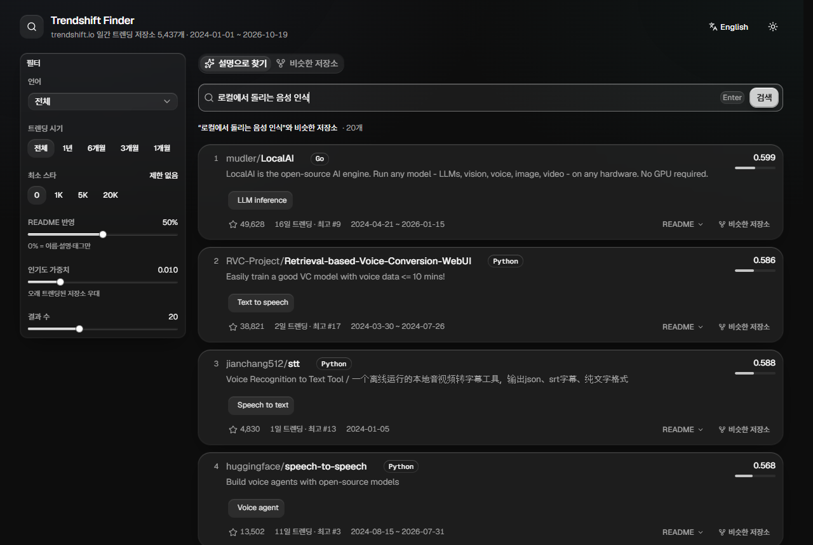

# browse-trendshift

[English](README.md) | **한국어**

**바로 써보기: https://browse-trendshift.vercel.app**

[trendshift.io](https://trendshift.io)의 날짜별 일간 트렌딩 저장소(2024-01-01~오늘)를 모두 수집하고,
원하는 프로젝트를 자연어(한국어/영어) 유사도 검색으로 찾아줍니다.



필요한 것을 문장으로 적으면 설명·태그·README가 가장 잘 맞는 트렌딩 저장소를 순서대로 보여주고,
저장소 하나를 고르면 비슷한 저장소를 찾아줍니다. 언어·트렌딩 시기·스타 수로 거를 수 있습니다.

## 사용법

```bash
uv sync
uv run scrape.py          # 날짜별 데이터 수집 → data/daily/YYYY-MM-DD.json (재실행 시 없는 날짜만 받음)
uv run fetch_readmes.py   # 각 저장소의 GitHub README → data/readme/<id>.md
uv run build_index.py     # 저장소별 집계 + 임베딩 → data/index/
uv run search.py "PDF 문서를 마크다운으로 변환"
uv run search.py "rag framework" --lang Python --since 2025-06-01 -k 10
uv run search.py --like langgenius/dify        # 비슷한 저장소 찾기
```

### 웹 UI

```bash
cd web && npm install && npm run build && cd ..   # 최초 1회 (화면 수정 시 다시 빌드)
uv run server.py                                  # http://localhost:8600
```

화면은 [Solid Glass](https://github.com/deeplethe/solid-glass)(shadcn/ui 테마, MIT) 컴포넌트로 만든 React 앱이고,
`server.py`(FastAPI)가 API와 빌드된 화면을 함께 제공합니다. 화면 개발 시에는 `uv run server.py`를 띄운 채
`cd web && npm run dev`(http://localhost:5173, `/api`는 8600으로 프록시)를 쓰면 됩니다.
검색 링크는 `?q=검색어` / `?like=owner/repo` 형태로 공유할 수 있습니다.
화면 언어는 오른쪽 위 버튼으로 한국어/English를 바꿀 수 있습니다(기본값은 브라우저 언어).

### 서버 자동 실행

```bash
powershell -ExecutionPolicy Bypass -File schedule_server.ps1
```

- 로그온 시 서버를 자동 실행하는 작업(`BrowseTrendshiftServer`)을 등록합니다. 서버 로그는 `data/server.log`.
- 해제: `Unregister-ScheduledTask -TaskName BrowseTrendshiftServer -Confirm:$false`

### 매일 자동 업데이트

```bash
uv run update.py   # 새 날짜 수집 → 새 저장소 README → 증분 인덱스 (변경분만 임베딩, 보통 수십 초)
powershell -ExecutionPolicy Bypass -File schedule_daily.ps1   # 매일 10:00 실행하도록 작업 스케줄러 등록
```

- trendshift의 하루는 UTC 기준이라 10:00 KST(01:00 UTC)에 실행해 전날 최종 순위를 받습니다.
  trendshift는 하루 중에도 순위를 다시 계산하고 전날 목록도 다음 날까지 바뀌므로, 최근 3일(오늘 포함)은 매번 다시 받습니다.
- PC가 꺼져 있었으면 켜진 뒤 실행됩니다. 로그는 `data/update.log`.
- 실행 중인 서버는 인덱스가 바뀌면 다음 요청 때 자동으로 새 인덱스를 읽습니다.
- 해제: `Unregister-ScheduledTask -TaskName BrowseTrendshiftUpdate -Confirm:$false`

## 무료 배포 (Vercel + Cloudflare Workers AI + GitHub Actions)

배포판에는 GPU 서버가 필요 없습니다. 인덱스를 int8로 내보내고(`export_index.py`, 약 44MB) Vercel 함수(`api/`)가
검색하며, 검색어는 같은 bge-m3 모델로 [Cloudflare Workers AI](https://developers.cloudflare.com/workers-ai/)에서
임베딩합니다(무료: 하루 10,000 neurons ≈ 입력 900만 토큰). GitHub Actions(`.github/workflows/daily.yml`)가 매일
데이터를 갱신하고 다시 배포합니다.

1. Cloudflare: **Workers AI: Read** 권한의 API 토큰을 만들어 `.env`에 넣고(`.env.example` 참고),
   Workers AI가 로컬과 같은 벡터를 내는지 확인합니다: `uv run check_cloudflare.py`
2. Vercel: `npx vercel link`(조직·프로젝트 ID가 담긴 `.vercel/project.json` 생성) 후 Vercel 환경변수에
   `CLOUDFLARE_ACCOUNT_ID`, `CLOUDFLARE_API_TOKEN`을 넣습니다.
3. GitHub secrets: `CLOUDFLARE_ACCOUNT_ID`, `CLOUDFLARE_API_TOKEN`, `VERCEL_TOKEN`, `VERCEL_ORG_ID`, `VERCEL_PROJECT_ID`
4. 로컬에서 만든 벡터를 시드로 올립니다(러너 CPU 전체 임베딩은 6시간 제한 안에 끝나지 않음):
   `data/index/{keys.json,embeddings.npy,chunk_embeddings.npy,meta.json}`을 `index-seed.tar.gz`로 묶어
   `gh release create index-seed index-seed.tar.gz --draft`. 그다음 워크플로를 한 번 직접 실행합니다.
   이후 매일 01:00 UTC에 새 텍스트만 Cloudflare로 임베딩합니다.

데이터는 git이 아니라 Actions 캐시에 보관합니다. 캐시가 지워지면(7일간 실행 없음) 다음 실행이 시드부터 다시 시작합니다.

## 동작 방식

- **수집**: trendshift 홈페이지의 날짜 선택기는 Next.js Server Action
  `getRepositoryRecommendationsByDate(date, "all")`을 호출합니다. 이를 직접 POST로 호출해 하루 25개씩 받습니다.
  Action ID는 사이트 재배포 시 바뀌므로 매 실행 때 JS 청크에서 자동으로 찾습니다.
- **집계**: 같은 저장소를 하나로 합치고 트렌딩 일수, 최고 순위, 처음/마지막 트렌딩 날짜, 태그를 기록합니다.
- **README**: `raw.githubusercontent.com`(API 한도 없음)에서 흔한 파일명을 먼저 시도하고, 없으면
  `gh auth token`/`GITHUB_TOKEN`으로 REST API를 사용합니다. 배지·이미지·HTML·코드블록·URL을 지우고
  앞부분부터 최대 8개 청크(약 1,200자)로 나눕니다.
- **검색**: 다국어 임베딩 모델(`BAAI/bge-m3`)로 ① 이름+설명+태그+언어, ② README 각 청크를 벡터화합니다.
  저장소 점수 = `(1-w)·메타 유사도 + w·가장 잘 맞는 README 청크 유사도` (`--readme-weight`, 기본 0.5).
  트렌딩 일수가 많은 저장소에 작은 가중치(`popularity_weight`)를 줍니다.
  더 가벼운 모델이 필요하면 `build_index.py --model intfloat/multilingual-e5-small`.
- **GPU**: `pyproject.toml`이 CUDA 12.8용 torch를 받도록 설정되어 있습니다 (RTX 50 시리즈 지원). GPU가 없으면 CPU로 동작합니다.

## 라이선스

MIT. `web/`의 UI 컴포넌트는 [Solid Glass](https://github.com/deeplethe/solid-glass)(MIT, `web/LICENSE.solid-glass`)에서 가져왔습니다.
