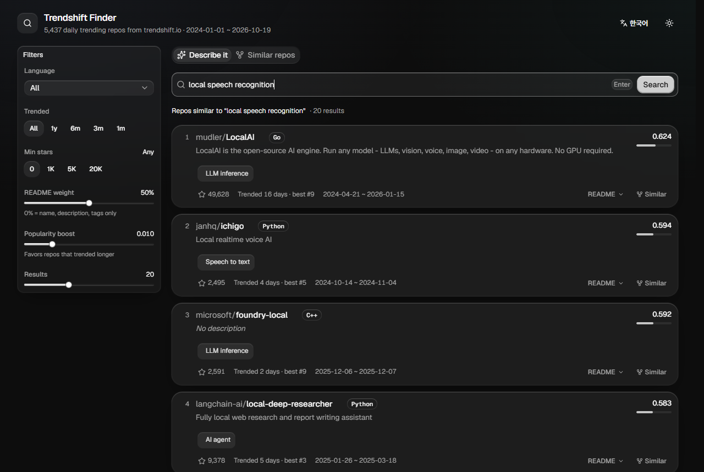

# browse-trendshift

**English** | [한국어](README.ko.md)

Collects every day of [trendshift.io](https://trendshift.io)'s daily trending repositories (2024-01-01 to today)
and helps you find the project you need with natural-language similarity search (English, Korean and more).



Describe what you need and get trending repositories ranked by how well their description, topics and README match,
or pick a repository and find similar ones. Filter by language, when it trended and stars.

## Usage

```bash
uv sync
uv run scrape.py          # daily rankings -> data/daily/YYYY-MM-DD.json (re-runs only fetch missing days)
uv run fetch_readmes.py   # each repo's GitHub README -> data/readme/<id>.md
uv run build_index.py     # aggregate per repo + embed -> data/index/
uv run search.py "convert PDF documents to markdown"
uv run search.py "rag framework" --lang Python --since 2025-06-01 -k 10
uv run search.py --like langgenius/dify        # find similar repositories
```

### Web UI

```bash
cd web && npm install && npm run build && cd ..   # once (rebuild after UI changes)
uv run server.py                                  # http://localhost:8600
```

The UI is a React app built with [Solid Glass](https://github.com/deeplethe/solid-glass) (a shadcn/ui theme, MIT),
and `server.py` (FastAPI) serves both the API and the built UI. For UI development, keep `uv run server.py` running
and use `cd web && npm run dev` (http://localhost:5173, `/api` is proxied to 8600).
Searches can be shared as `?q=query` / `?like=owner/repo` links.
The top-right button switches the UI between English and Korean (defaults to the browser language).

### Start the server at logon

```bash
powershell -ExecutionPolicy Bypass -File schedule_server.ps1
```

- Registers a scheduled task (`BrowseTrendshiftServer`) that starts the server at logon. Server log: `data/server.log`.
- Remove: `Unregister-ScheduledTask -TaskName BrowseTrendshiftServer -Confirm:$false`

### Daily update

```bash
uv run update.py   # new days -> READMEs of new repos -> incremental index (only changed text is embedded; usually seconds)
powershell -ExecutionPolicy Bypass -File schedule_daily.ps1   # register a Task Scheduler job that runs it daily at 10:00
```

- Trendshift days are in UTC, so 10:00 KST (01:00 UTC) picks up the previous day's ranking.
  Trendshift recomputes rankings during the day and still revises a day's list the next day,
  so the last 3 days (including today) are always re-downloaded.
- If the PC was off at the scheduled time, the job runs once it is back on. Log: `data/update.log`.
- A running server picks up the new index on the next request after it changes.
- Remove: `Unregister-ScheduledTask -TaskName BrowseTrendshiftUpdate -Confirm:$false`

## Free hosting (Vercel + Cloudflare Workers AI + GitHub Actions)

The hosted version needs no GPU server: the index is exported as int8 (`export_index.py`, ~44 MB),
Vercel functions (`api/`) search it, and queries are embedded with the same bge-m3 model on
[Cloudflare Workers AI](https://developers.cloudflare.com/workers-ai/) (free: 10,000 neurons/day ≈ 9M input tokens).
A GitHub Actions workflow (`.github/workflows/daily.yml`) updates the data daily and redeploys.

1. Cloudflare: create an API token with **Workers AI: Read**, put it in `.env` (see `.env.example`), and check
   that Workers AI reproduces the local vectors: `uv run check_cloudflare.py`.
2. Vercel: `npx vercel link` (creates `.vercel/project.json` with the org and project IDs), then add
   `CLOUDFLARE_ACCOUNT_ID` and `CLOUDFLARE_API_TOKEN` as Vercel environment variables.
3. GitHub secrets: `CLOUDFLARE_ACCOUNT_ID`, `CLOUDFLARE_API_TOKEN`, `VERCEL_TOKEN`, `VERCEL_ORG_ID`, `VERCEL_PROJECT_ID`.
4. Run the workflow once by hand with backend `local` (full build on the runner CPU, a few hours).
   After that it runs daily at 01:00 UTC and only embeds new text, on Cloudflare.

Data lives in the Actions cache, not in git. If the cache is evicted (no run for 7 days), run step 4 again.

## How it works

- **Collection**: trendshift's date picker calls the Next.js Server Action
  `getRepositoryRecommendationsByDate(date, "all")`. We POST to it directly and get 25 repositories per day.
  The action ID changes whenever the site is redeployed, so it is discovered from the JS chunks on every run.
- **Aggregation**: entries for the same repository are merged, recording days trended, best rank,
  first/last trending date and tags.
- **README**: common file names are tried on `raw.githubusercontent.com` first (no API rate limit), then the
  REST API with `gh auth token` / `GITHUB_TOKEN`. Badges, images, HTML, code blocks and URLs are stripped,
  and the start of the README is split into up to 8 chunks of about 1,200 characters.
- **Search**: a multilingual embedding model (`BAAI/bge-m3`) embeds (1) name + description + tags + language and
  (2) each README chunk. Repository score = `(1-w)·metadata similarity + w·best README chunk similarity`
  (`--readme-weight`, default 0.5), plus a small boost (`popularity_weight`) for repos that trended on many days.
  For a lighter model, use `build_index.py --model intfloat/multilingual-e5-small`.
- **GPU**: `pyproject.toml` installs torch built for CUDA 12.8 (supports RTX 50 series). Without a GPU it runs on CPU.
